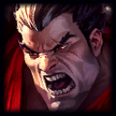
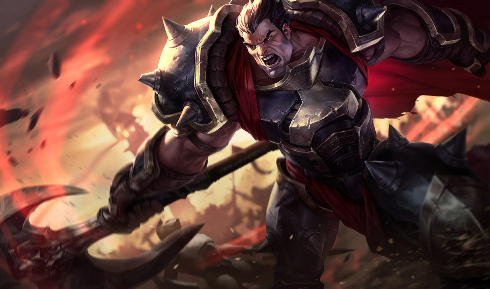

<p align="center">
  
</p>

<h1 align="center">Darius Coach</h1>

<p align="center"><b>A matchup coach for Darius players, built for the draft pick stage.</b></p>

<p align="center"></p>

## Why I made this

I main Darius top lane and sometimes play him in the jungle. During champion select I kept doing the same thing: googling "*{champion}* abilities", digging through the League of Legends Wiki for the one section I needed, and trying to remember how that matchup works, all before the timer ran out.

Darius Coach puts that into a single screen. Once I see what I'm laning against in draft, I:

1. **Search the enemy champion** and get clean cards for each ability (cooldowns, costs, ranges and per-rank values), taken directly from the wiki.
2. **Ask the coach** "How should I play Darius into them? What should I build?" and get **3 quick tips** (game plan, the ability to respect, item build) before the game loads.
3. **Ask follow-ups** about levels 1-3, trading windows, runes or wave management when I have time.

The coach is personal. It reads my **Playbook**: my own habits and preferences, such as which jungle camp I ward to track the enemy jungler, preferring Youmuu's Ghostblade over Stridebreaker, and building crit when it's viable. Its advice fits how I actually play instead of a generic guide.

## Features

- **Searchable champion picker** using Riot's Data Dragon champion list.
- **Clean ability cards** parsed from the Abilities section of the LoL Wiki.
- **AI matchup coach** (Claude). Its prompt includes the exact ability text for Darius and the opponent, plus the Top/Jungle role. It only calls Claude when you click Send.
- **Playbook**: add, edit or delete your habits in the sidebar. They are saved to `data/knowledge.json` and sent to the coach with every message.

## Run it

```bash
pnpm install
pnpm start          # → http://localhost:3000
```

### Connecting Claude

| Option | What it uses | Setup |
|---|---|---|
| **A. Your Claude account (default)** | Your Claude Pro/Max subscription, through the `claude` CLI | Install [Claude Code](https://claude.com/claude-code) and run `claude` once to log in. No API key needed. |
| **B. API key** | Pay-per-use billing on the Claude Console | `cp .env.example .env`, then set `ANTHROPIC_API_KEY=...` |

When an API key is present, option B is used. Optional settings: `CHAT_PROVIDER=cli|api`, `CLAUDE_MODEL` (default `claude-opus-5-5`), `CLAUDE_EFFORT` (default `medium`), `PORT`, `PLAYBOOK_FILE`.

## How it works

| Path | Role |
|---|---|
| `server/champions.js` | Champion list from Riot Data Dragon |
| `server/wiki.js` | Fetches only the "Abilities" section through the wiki's MediaWiki API (cached for 6h) |
| `server/abilityParser.js` | Turns the wiki HTML into structured ability cards |
| `server/knowledge.js` | Playbook storage (JSON file) |
| `server/prompt.js` | Coach system prompt: abilities + playbook + answer format |
| `server/providers/` | Claude through the Anthropic SDK (`api.js`) or the `claude` CLI (`cli.js`) |
| `public/` | Plain HTML, CSS and JS with no build step |

```bash
pnpm test
```

## Credits

Ability data comes from the [League of Legends Wiki](https://wiki.leagueoflegends.com/) (CC BY-SA). Champion art and data come from Riot Games' Data Dragon.

Darius Coach isn't endorsed by Riot Games and doesn't reflect the views or opinions of Riot Games or anyone officially involved in producing or managing Riot Games properties. Riot Games and all associated properties are trademarks or registered trademarks of Riot Games, Inc.
